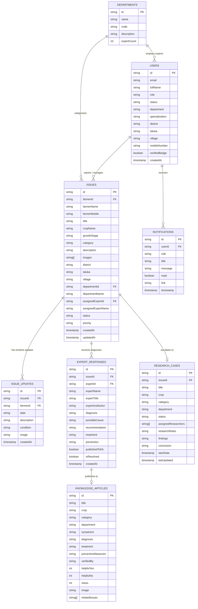

# 🗄️ Database Schema & Data Models Documentation
## CropCare Digital Agricultural Advisory Platform

- **Database Engine**: Google Cloud Firestore (Document NoSQL)
- **Primary Model**: Denormalized Document-Reference hybrid with fast localized reads
- **Version**: 2.0.0

---

## 1. Entity-Relationship Diagram (ERD)

---

## 2. Collections & Field Specifications

### 2.1 Collection: `users`
Stores user profile information for all roles.
- **Document ID**: Firebase UID (e.g., `5W9zK...` or `EXP-101`)
- **Fields**:
  - `id` *(string, required)*: Unique identifier.
  - `email` *(string, required)*: User email address.
  - `fullName` *(string, required)*: Full legal or academic name.
  - `role` *(string, required)*: `Farmer` \| `Agricultural Expert / Researcher` \| `Agriculture Department Admin`.
  - `status` *(string, required)*: `Active` \| `Pending Approval` \| `Suspended`.
  - `department` *(string, optional)*: Agricultural division (e.g., `Plant Pathology`).
  - `specialization` *(string, optional)*: Sub-specialty (e.g., `Crop Diseases & Diagnostics`).
  - `institution` *(string, optional)*: University or research center name.
  - `employeeId` *(string, optional)*: State government or university staff badge ID.
  - `district` *(string, optional)*: Administrative district.
  - `taluka` *(string, optional)*: Administrative sub-district (taluka).
  - `village` *(string, optional)*: Village name.
  - `mobileNumber` *(string, optional)*: Contact phone number.
  - `verifiedBadge` *(boolean)*: Certification seal granted by Directorate Admin.
  - `createdAt` *(ISO timestamp)*: Registration timestamp.

---

### 2.2 Collection: `issues`
Core crop problem case records reported by farmers.
- **Document ID**: Formatted ID (e.g., `ISSUE-1791653114512`)
- **Fields**:
  - `id` *(string, required)*: Primary key.
  - `farmerId` *(string, required)*: UID of the reporting farmer.
  - `farmerName` *(string, required)*: Farmer's full name.
  - `farmerMobile` *(string)*: Farmer contact number.
  - `title` *(string, required)*: Problem title or symptom summary.
  - `cropName` *(string, required)*: Affected crop (e.g., `Tomato`, `Sugarcane`, `Cotton`).
  - `growthStage` *(string)*: `Seedling` \| `Vegetative` \| `Flowering` \| `Maturity`.
  - `category` *(string)*: `Crop Disease` \| `Pest Attack` \| `Nutrient Deficiency` \| `Weather Damage`.
  - `description` *(string, required)*: Field observation description.
  - `images` *(array of URLs)*: Photograph attachments.
  - `state` *(string)*: State name (default: `Maharashtra`).
  - `district` *(string)*: District location.
  - `taluka` *(string)*: Taluka location.
  - `village` *(string)*: Village location.
  - `coordinates` *(string)*: GPS location string.
  - `departmentId` *(string, required)*: Target division ID.
  - `departmentName` *(string, required)*: Target division name.
  - `assignedExpertId` *(string)*: Assigned researcher UID.
  - `assignedExpertName` *(string)*: Name of assigned expert.
  - `status` *(string, required)*: `Submitted` \| `Under Review` \| `Expert Responded` \| `Farmer Updating` \| `Resolved` \| `Research Required`.
  - `priority` *(string)*: `Low` \| `Medium` \| `High` \| `Urgent`.
  - `createdAt` *(ISO timestamp)*: Case submission timestamp.
  - `updatedAt` *(ISO timestamp)*: Last update timestamp.

---

### 2.3 Collection: `issue_updates`
Chronological progress updates and spray responses.
- **Document ID**: `upd_<timestamp>`
- **Fields**:
  - `id` *(string)*: Unique update ID.
  - `issueId` *(string, required)*: Parent issue reference.
  - `farmerId` *(string, required)*: Farmer reference.
  - `date` *(string, YYYY-MM-DD)*: Observation date.
  - `description` *(string)*: Notes regarding condition or treatments applied.
  - `condition` *(string)*: `Initial` \| `Recovering` \| `Same` \| `Worse` \| `Resolved`.
  - `image` *(string, nullable)*: Optional progress photograph.
  - `createdAt` *(ISO timestamp)*: Creation timestamp.

---

### 2.4 Collection: `expert_responses`
Certified scientific diagnoses and prescriptions.
- **Document ID**: `resp_<timestamp>`
- **Fields**:
  - `id` *(string)*: Unique prescription ID.
  - `issueId` *(string, required)*: Parent issue reference.
  - `expertId` *(string, required)*: Accredited researcher UID.
  - `expertName` *(string)*: Full researcher name.
  - `expertTitle` *(string)*: Academic designation.
  - `expertInstitution` *(string)*: University affiliation.
  - `diagnosis` *(string, required)*: Identified pathogen or pest organism.
  - `possibleCause` *(string)*: Environmental or agronomic trigger.
  - `recommendation` *(string)*: Immediate cultural practice advice.
  - `treatment` *(string, required)*: Chemical/biological fungicide/pesticide dosage schedule.
  - `prevention` *(string)*: Preventive measures for subsequent seasons.
  - `publishedToKb` *(boolean)*: Whether cross-published to public Knowledge Base.
  - `isResolved` *(boolean)*: True if case is marked fully resolved.
  - `createdAt` *(ISO timestamp)*: Prescription timestamp.

---

### 2.5 Collection: `research_cases`
Formal laboratory and field trial escalation records.
- **Document ID**: `RC-<number>` (e.g., `RC-301`)
- **Fields**:
  - `id` *(string)*: Research case ID.
  - `issueId` *(string)*: Originating field case reference.
  - `title` *(string, required)*: Scientific research project title.
  - `crop` *(string)*: Crop under trial.
  - `category` *(string)*: Problem classification.
  - `department` *(string)*: Leading university division.
  - `status` *(string)*: `Investigation Started` \| `Trials Ongoing` \| `Concluded`.
  - `assignedResearchers` *(array of strings)*: List of investigating scientists.
  - `researchNotes` *(string)*: Laboratory notes and PCR isolation protocols.
  - `findings` *(string)*: Experimental observations and tolerance thresholds.
  - `conclusion` *(string)*: Published findings and interim advisory recommendations.
  - `startDate` *(string, YYYY-MM-DD)*: Research initiation date.
  - `lastUpdated` *(string, YYYY-MM-DD)*: Most recent log update.

---

### 2.6 Collection: `knowledge_articles`
Curated advisory articles and tested solutions.
- **Document ID**: `KB-<number>` (e.g., `KB-101`)
- **Fields**:
  - `id` *(string)*: Knowledge article ID.
  - `title` *(string)*: Solution advisory title.
  - `crop` *(string)*: Target crop.
  - `category` *(string)*: Disease, pest, or nutrient category.
  - `department` *(string)*: Specialization division.
  - `symptoms` *(string)*: Symptom description.
  - `diagnosis` *(string)*: Pathogen name.
  - `treatment` *(string)*: Complete treatment recipe and dosage.
  - `preventiveMeasures` *(string)*: Integrated Pest Management (IPM) guidelines.
  - `verifiedBy` *(string)*: Accredited specialist certification seal.
  - `helpfulYes` *(integer)*: Upvote counter.
  - `helpfulNo` *(integer)*: Downvote counter.
  - `views` *(integer)*: Reading view counter.
  - `image` *(string)*: Reference photograph.
  - `relatedIssues` *(array of strings)*: Field case references.

---

### 2.7 Collection: `departments`
State agriculture divisions.
- **Document ID**: `dept_<id>` (e.g., `dept_1`)
- **Fields**:
  - `id` *(string)*: Division identifier.
  - `name` *(string)*: Department name (e.g., `Plant Pathology`).
  - `code` *(string)*: Acronym code (e.g., `PATH`).
  - `description` *(string)*: Division operational scope.
  - `expertCount` *(integer)*: Number of accredited scientists in division.

---

### 2.8 Collection: `notifications`
Real-time user alert records.
- **Document ID**: `notif_<timestamp>`
- **Fields**:
  - `id` *(string)*: Notification identifier.
  - `userId` *(string)*: Target user UID, `all_experts`, or `all`.
  - `role` *(string)*: Role audience filter.
  - `title` *(string)*: Alert title.
  - `message` *(string)*: Notification summary.
  - `read` *(boolean)*: Read status flag.
  - `link` *(string)*: Route hyperlink destination.
  - `timestamp` *(ISO timestamp)*: Notification generation timestamp.
