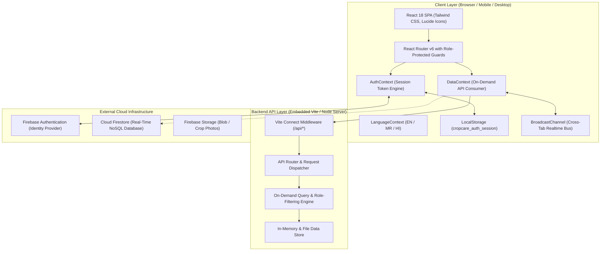
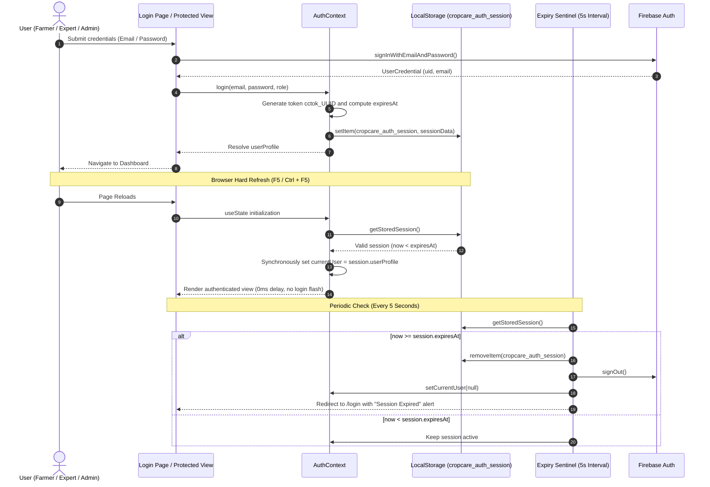
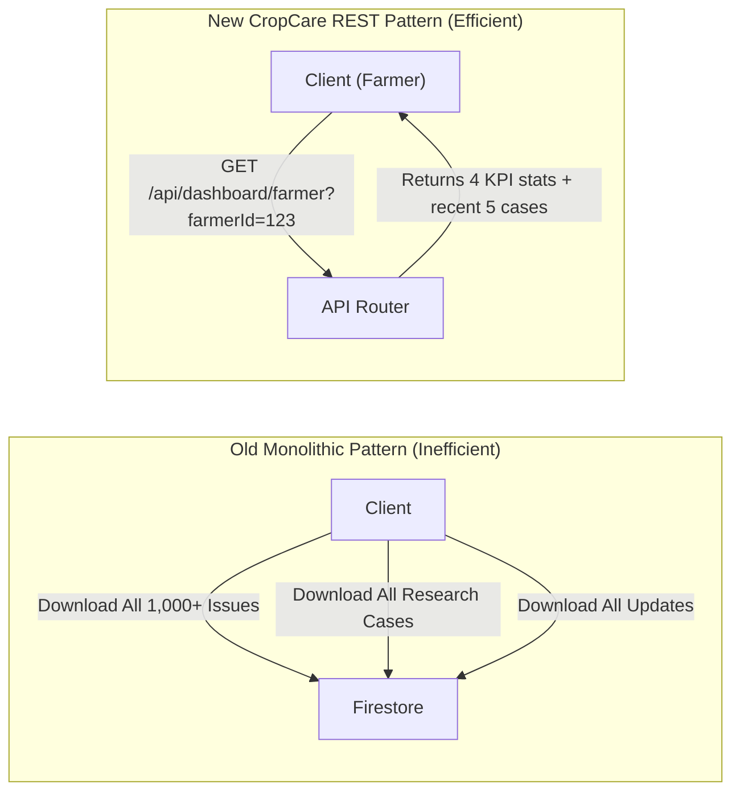

# 🏛️ System Architecture Document
## CropCare Digital Advisory Platform

- **Architecture Style**: Component-Based Single-Page Architecture (SPA) with Embedded Multi-Sync REST API Middleware
- **Version**: 2.0.0
- **Status**: Production Reference

---

## 1. High-Level System Architecture

The CropCare platform utilizes a modern, resilient multi-tier topology. It combines an embedded Connect/Express-compatible REST API server with Firebase Cloud Services and client-side reactive state management.



---

## 2. Component Breakdown

### 2.1 Presentation & Application Layer (`src/`)
- **Pages**: Role-segregated views:
  - `src/pages/farmer/`: `FarmerDashboardPage`, `ReportProblemPage`, `MyProblemsPage`, `IssueDetailsPage`, `SavedSolutionsPage`, `FarmerProfilePage`.
  - `src/pages/expert/`: `ExpertDashboardPage`, `AssignedCasesPage`, `ExpertCaseReviewPage`, `ResearchCasesPage`, `ResearchCaseDetailsPage`, `ExpertProfilePage`.
  - `src/pages/admin/`: `AdminDashboardPage`, `ApproveResearchersPage`, `ManageUsersPage`, `ManageDepartmentsPage`, `ManageIssuesPage`, `ManageResearchPage`, `AdminAnalyticsPage`.
  - `src/pages/public/`: `HomePage`, `KnowledgeBasePage`, `KnowledgeArticleDetailsPage`, `AboutPage`, `ContactPage`.
  - `src/pages/auth/`: `LoginPage`, `AdminLoginPage`, `FarmerRegisterPage`, `ForgotPasswordPage`.
- **Protected Route Guard (`ProtectedRoute.jsx`)**:
  - Enforces role access (`Farmer`, `Agricultural Expert / Researcher`, `Agriculture Department Admin`).
  - Checks `authLoading && !currentUser` to prevent premature redirection during refresh.
  - Intercepts unapproved researchers with a verification status screen.
  - Automatically redirects authenticated users away from incorrect portals into their designated workspace.

---

## 3. Authentication & Session Token Lifecycle

CropCare features a custom **Cryptographic Session Token Engine** designed to solve hard refresh logouts and enforce strict role-based session limits:

### 3.1 Role Session Durations
```javascript
export const SESSION_DURATIONS = {
  'Farmer': 15 * 60 * 1000,                            // 15 Minutes (high turnover)
  'Agricultural Expert / Researcher': 15 * 60 * 1000,  // 15 Minutes (confidential prescriptions)
  'Agriculture Department Admin': 24 * 60 * 60 * 1000  // 24 Hours (command center shift)
};
```

### 3.2 Session Lifecycle Sequence



---

## 4. Backend REST API Architecture

The embedded API server runs natively through the Vite Connect middleware pipeline (`server/apiRouter.js`), with data stored in `server/data/store.js`.

### 4.1 On-Demand Data Delivery Model
Instead of subscribing the client to all collections in Firestore, the application queries endpoints tailored to specific contexts:



### 4.2 Standard API Response Specification
All endpoints adhere to an enterprise REST contract:
```json
{
  "success": true,
  "data": { ... },
  "meta": {
    "total": 42,
    "count": 10,
    "timestamp": "2026-10-11T13:00:00.000Z"
  }
}
```

Error response contract:
```json
{
  "success": false,
  "error": "Resource not found or unauthorized access."
}
```

---

## 5. Multi-Sync Data Resiliency Architecture

CropCare integrates a three-tier synchronization strategy:
1. **Primary REST API Layer**: Clean HTTP client for standard page loads and on-demand queries (`/api/*`).
2. **Cloud Firestore Sync**: Real-time cloud persistence when internet connectivity and Firebase services are active.
3. **BroadcastChannel Bus (`realtimeService`)**: Instant cross-tab event broadcasting (e.g., when an issue is reported in tab A, tab B updates immediately without hitting the network).

---

## 6. Security & Threat Mitigation Architecture

| Threat / Risk | Architectural Defense |
| :--- | :--- |
| **Session Hijacking** | Cryptographically secure tokens (`crypto.randomUUID()`) + automatic 15-minute expiration for field users. |
| **Privilege Escalation** | Two-tier role enforcement: Route-level guards in `ProtectedRoute.jsx` and server-level role verification. |
| **Cross-Site Scripting (XSS)** | React JSX auto-escaping, sanitized text nodes, and rejection of unsafe HTML rendering. |
| **Credential Phishing** | Clear visual separation between public portal (`/login`) and Directorate Administrative Access (`/admin/login`). |
| **Data Scraping** | Parameterized server-side pagination with maximum result boundaries on all collection queries. |
